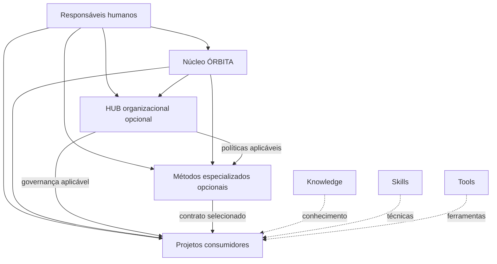

# ORB-EVO-001 — 03: Arquitetura metodológica

**Data:** 26/11/2026. **Estado:** proposta de arquitetura candidata, entregue para homologação documental; não integrada nem vigente como norma. **Baseline:** `c613f970a6b08e0d1c4376682850c9ef659c0e2d`. PRs #27–#30 integradas; etapas 01 e 02 encerradas e main confirmada. **Autorização:** etapa 03 exclusivamente. [Plano aprovado](007-ORB-EVO-001-PLANO-DE-EVOLUCAO.md).

A aprovação desta arquitetura estabelecerá uma direção de desenho para as etapas seguintes, não alterará o contrato de trabalho vigente nem autorizará adoção/migração de consumidores. Integração normativa, pilotos e publicação continuam nas etapas 10, 11 e 12, com gates próprios. Nenhuma versão nova, licença, ferramenta ou método especializado é publicado por este documento.

## 1. Problema e decisão de arquitetura

A [auditoria 01](007-01-AUDITORIA-INTEGRAL.md) demonstrou lacunas de composição, precedência e distribuição (D-01/D-21), tensão de escopo (D-06), distinção de estados (D-04) e exposição contextual (D-27). A [auditoria 02](007-02-AUDITORIA-HUB-E-PROJETOS.md) corroborou esses fenômenos em fontes governadas, principalmente E-01/E-02/E-04/E-05/E-06/E-08/E-09/E-15/E-17/E-19/E-22. O modelo abaixo é síntese candidata dessas evidências, não auditoria repetida nem demonstração de eficácia quantitativa.

| Alternativa | Benefício | Limitação | Decisão proposta |
| --- | --- | --- | --- |
| Núcleo único contendo procedimentos de todos os domínios | Uma fonte aparente | Acoplamento a organizações e tecnologias, atualização transversal e excesso de leitura | Não adotar |
| Cada projeto define todo o seu método | Autonomia local | Redescoberta, inconsistência, conflitos e perda de controles comuns | Não adotar |
| Hierarquia rígida por nível, em que a camada superior decide qualquer assunto | Precedência simples | HUB poderia decidir versão/implementação de produto sem prova; regra genérica prevaleceria sobre runbook específico | Não adotar |
| Composição modular com autoridade por assunto e restrições cumulativas | Reuso seletivo, autonomia dentro de limites, fontes independentes, governança rastreável | Exige declaração mínima de aplicabilidade, refs e resolução de conflitos | Recomendada |

Preservar O-R-B-I-T-A, autoridade humana, separação de papéis, incrementalidade, identidade única, canonicidade, segurança, evidências, homologação, autorização operacional, retomada por preservação e COM-001, conforme [papéis](../docs/03-PAPEIS-E-RESPONSABILIDADES.md), [governança](../docs/05-GOVERNANCA-E-HOMOLOGACAO.md), [aplicação](../docs/08-APLICACAO-E-EVOLUCAO.md), [identidade](../docs/10-IDENTIDADE-E-AMBIENTE-DO-PROJETO.md), [segurança](../docs/12-SEGURANCA-E-INTEGRIDADE.md) e [contrato de trabalho](../onboarding/CONTRATO-DE-TRABALHO.md). O projeto simples continua viável com o mínimo já descrito em docs 08.

## 2. Componentes e fronteiras

As setas representam vínculos de composição possíveis, não dependência obrigatória, transferência de propriedade ou hierarquia de pessoas. As capacidades transversais podem apoiar também núcleo, HUB e métodos quando seu escopo e acesso permitirem. O desenho não exige criar repositório por camada, nem que todo método esteja subordinado a um HUB. Uma organização pode consumir método externo sem ter autoridade para alterá-lo.

| Componente | Autoridade primária | Conteúdo próprio | Limites |
| --- | --- | --- | --- |
| ÓRBITA | Mantenedor do núcleo e responsáveis por sua evolução | Princípios, papéis, gates universais, segurança, evidência, identidade, critérios de adoção e evolução | Não escolhe stack, ferramenta, cliente, runbook, modelo comercial ou design de um consumidor |
| HUB opcional | Responsável organizacional no escopo delegado | Catálogo, fronteiras de aplicação, políticas comuns, relações, padrões internos, decisões compartilhadas, coordenação de impacto | Não é dono automático de todo repositório, não duplica manuais, não atesta runtime nem libera operação de produto |
| Método especializado | Responsável pelo contrato da categoria | Fluxo, critérios técnicos, referências, templates, procedimentos reutilizáveis, limitações, versões e dependências | Não define requisitos de negócio nem estado/ambiente do consumidor; não rebaixa restrições universais ou organizacionais aplicáveis |
| Projeto | Responsável pelo produto e donos de ambientes/dados, conforme delegação | Objetivo, escopo, requisitos, arquitetura, código, dados, tarefas, decisões, riscos, testes, runbooks, integração, releases e operação | Não altera fonte externa, amplia acesso, reduz gate ou publica sem autoridade correspondente |
| Knowledge | Mantenedor da base no escopo de origem | Conclusão comprovada, validade, fonte, revalidação, limites | Não vira segunda especificação, tarefa, hipótese vigente, log ou autorização |
| Skills | Curador da ficha e fonte intelectual/profissional correspondente | Técnicas, método profissional, alternativas, critérios de uso, limitações, evidências e referências | Não confundir com método de produção; não impor framework ou substituir aceite |
| Tools | Proprietário/mantenedor do componente | Código, licença, versões, integridade, contrato, segurança, suporte e limites | Catálogo não confere titularidade, licença, acesso, instalação, uso externo, atualização ou autorização operacional |

Papéis humanos continuam separados de camadas: mantenedor do núcleo, responsável do HUB, mantenedor de método, responsável do projeto, dono de ambiente/dados podem ser a mesma pessoa ou pessoas distintas; competência e delegação devem ser inequívocas no assunto. Planejador e implementador podem usar a mesma ferramenta, mas nenhum se torna homologador. Git preserva o registro, não decide. Contratos de fornecedor, lei e controles de segurança aplicáveis não são dispensados por aprovação de conveniência.

### 2.1 Composições possíveis

| Perfil | Composição mínima adequada | Limite |
| --- | --- | --- |
| Projeto independente simples | ÓRBITA + projeto | Não criar HUB ou método fictício apenas para cumprir o desenho |
| Projeto especializado independente | ÓRBITA + método(s) selecionado(s) + projeto | Método externo pode ser referência, sem autoridade sobre seu mantenedor |
| Organização com produtos distintos | ÓRBITA + HUB + métodos aplicáveis + projetos | Inclusão explícita, não inferida por proprietário, hospedagem ou marca |
| Produto híbrido ou integração | ÓRBITA + projeto + contratos de domínio/fornecedores; HUB se aplicável | Delimitar assunto e interface; conflito de métodos não é resolvido pela ordem de leitura |

É possível ter mais de um HUB por fronteira contratual ou organizacional, sem criar sub-hierarquia obrigatória. Quando dois conjuntos de políticas alcançarem o mesmo projeto, aplicar as restrições compatíveis e explicitar qual responsável decide cada domínio. Conflito real exige decisão dos responsáveis competentes; não escolher o HUB mais recente. Não herdar automaticamente relações transitivas: depender de uma ferramenta ou projeto não inclui o consumidor no HUB do fornecedor. Referências informativas podem ser circulares, mas a aplicação de autoridade não pode depender de ciclos irresolvíveis.

## 3. Autoridade e precedência por assunto

Distinguir três perguntas: **quem tem direito de decidir**, **qual contrato aplica-se** e **qual fonte prova o estado real**. Uma fonte pode responder uma dessas perguntas sem responder as outras. A precedência não é simplesmente "documento mais novo", "documento mais específico" ou "main sempre vence".

| Assunto | Fonte primária | Precedência e fronteira |
| --- | --- | --- |
| Governança universal | Especificação e contrato ÓRBITA adotados | Camadas inferiores complementam sem autoaprovação, expansão silenciosa ou dispensa de controles |
| Política organizacional e inclusão de consumidores | Decisão e política HUB aplicável | Somente dentro da delegação e lista/critério aprovado; não inclui todos por associação |
| Fluxo técnico e critérios da categoria | Método especializado adotado, inclusive exceções reconhecidas | Especifica como cumprir o núcleo/HUB; não prova implantação |
| Requisito, arquitetura e risco do produto | Projeto e decisão do responsável | Especificidade local prevalece nas decisões de produto que lhe pertencem, dentro das restrições aplicáveis |
| Operação em ambiente real | Runbook vigente do consumidor + contratos de dependências + autorização do ambiente | A autorização está associada a alvo e operação; não substituir método aprovado por conveniência |
| Versão de fornecedor | Manifesto/release/commit do fornecedor | Não prova consumo; lock e evidência de instalação são do consumidor |
| Estado de desenvolvimento | Ref/PR da tarefa, working copy preservada e evidência | Main representa integrado, não todo trabalho ativo |
| Estado publicado e runtime | Registro de release + verificação do ambiente | Snapshot de Git não é prova do destino; documentar diferenças e data |
| Técnica de solução | Skill aplicável, fonte profissional e decisão técnica do projeto | Técnica é instrumento, não autoridade para ampliar tarefa |
| Conhecimento e fato reutilizável | Entrada Knowledge e evidência primária | Orienta; dado volátil exige confirmação; não substitui contrato |
| Resumo e acompanhamento | README/roadmap/índices | Derivadas; não sobrescrevem decisão, release ou evidência primária |

### 3.1 Herança e adaptação

- **Invariantes:** princípios universais e restrições de segurança/autoridade; não podem ser desativados por instrução local do agente. Se houver necessidade de mudar o próprio núcleo, abrir processo de evolução pelo responsável do núcleo, sem alterar retroativamente o que já foi aceito.
- **Restrições aplicáveis:** políticas obrigatórias do HUB, do método e do ambiente acumulam-se quando compatíveis; maior rigor não implica nova aprovação humana para cada teste. Não importa política de organização não vinculada.
- **Decisões delegadas:** quando a fonte superior expressamente permite escolha (executor de QA, stack, formalidade, organização interna), o projeto escolhe e documenta conforme risco. A opção específica completa a genérica, não é conflito.
- **Preferências e defaults:** aplicam-se no escopo declarado se não houver decisão competente em sentido contrário. Perfis QA local-first e iconografia do mantenedor não são requisitos universais. Regra profissional recomendada também não é mandato.
- **Informação factual:** não se herda como verdade eterna. Copiar status de release ou contagem de arquivos não torna o fato atual. Verificar no responsável pela fonte e no ambiente quando pertinente.
- **Vigência e exceção:** proposta, draft, histórico, recomendação e regra vigente são categorias distintas. Uma exceção só é válida quando permitida pelo contrato, decidida pelo responsável competente e delimitada ao requisito/ambiente/risco. Exceção local não muda o método global.

Não se cria regra de "sempre seguir a mais restritiva" para contratos incompatíveis. Duas exigências podem ser mutuamente impossíveis; nesse caso, impedir o avanço dependente até resolução, sem inventar um procedimento.

## 4. Aplicabilidade e referências mínimas

Preferir a documentação já existente no projeto (AGENTS, README, decisões, locks e runbooks pertinentes). Não exigir um novo manifesto, arquivo ou sistema de configuração universal nesta etapa. A forma definitiva de instruções compactas é tema da etapa 06; estrutura e nomenclatura, etapa 08.

A composição precisa permitir recuperar, quando relevante:

| Informação | Exemplo sintético (não configuração vigente) |
| --- | --- |
| Identidade e responsável | Projeto Catálogo; responsável pelo produto e pelo ambiente identificáveis |
| Núcleo adotado | ÓRBITA, referência imutável A, fonte canônica e condição de revisão |
| HUB | Não aplicável; ou HUB X, política B, vínculo explicitamente autorizado |
| Método por domínio | Método de sites C para publicação; outro método D somente para integração autorizada |
| Regras locais e exceções | Decisão L no projeto; escopo, validade e gate afetado |
| Dependências relevantes | Ferramenta E: contrato F, versão/lock efetivo e ambiente permitido |
| Trabalho autorizado | Tarefa atual, ref/PR, objetivo, limites, critério de saída e última evidência |
| Origem e verificação | Fonte, revisão, data e o que foi comprovado (Git/relato/ambiente) |

Referência viva pode servir para descobrir atualização e ler índice, mas decisão material deve identificar versão/revisão usada. Adoção nova, continuidade no mesmo contexto e retomada interrompida não exigem a mesma quantidade de leituras. Antes de trabalho relevante, recuperar apenas fontes necessárias, consultar índice Knowledge conforme regra vigente e revalidar fatos voláteis ou mudanças com impacto. Reutilizar evidência comprovada quando seus pressupostos continuam válidos. Não prescrever repetição de auditoria completa por etapa/chat. Fatos desconhecidos permanecem desconhecidos.

## 5. Versões, compatibilidade e distribuição

Distinguir as referências abaixo, sem impor versionamento SemVer, tag, release binária, CI ou automação a todos os projetos.

| Objeto | Referência adequada | O que não demonstra |
| --- | --- | --- |
| Contrato metodológico adotado | Release/tag resolvida para revisão imutável ou commit exato, escopo, fonte | Atualização automática de consumidor |
| HEAD observado | SHA e momento da leitura | Compatibilidade ou pin adotado |
| Trabalho ativo | Branch/PR e SHA, mais estado local se relevante | Integração, aceite ou publicação |
| Artefato produzido | Versão, fonte, hash e manifesto quando aplicável | Instalação no destino |
| Consumo fixado | Lock/registro da revisão e artefato no consumidor | Runtime confirmado |
| Instalação/publicação | Ambiente, versão/artefato realmente aplicado, autorização e verificação | Cobertura de outras instalações |

Ciclo candidato de adoção: identificar fonte e versão aplicável → comparar delta relevante → avaliar compatibilidade, mudanças de contrato, requisitos de segurança/licença e dependências → testar proporcionalmente → aceitar e registrar revisão adotada → executar rollout apenas se autorizado → verificar destino e reconciliar registro. Ausência de nova versão publicada não impede uso de revisão Git fixada, quando a adoção for autorizada. A atualização de main no fornecedor não é gatilho automático para alteração de projeto. Um risco urgente de segurança exige comunicação e decisão, não atualização cega ou ignorar o risco em nome do pin.

Compatibilidade deve ser descrita pelo mantenedor quando existir um contrato versionado (requisitos, mudanças incompatíveis, limites e migração); consumidor confirma no seu contexto. Em ausência de declaração ou prova, manter compatibilidade não verificada. Um índice de dependências pode localizar impactos diretos e indiretos, mas não substitui a avaliação em cada consumidor nem autoriza alteração transitiva.

Publicação do próprio ÓRBITA: árvore pública não equivale à release estável, licença explícita, garantia de compatibilidade ou autorização de redistribuição. Etapa 12 deverá verificar titularidade, condições de licenciamento, critérios de maturidade, versão e distribuição; nenhuma licença é escolhida aqui. Não publicar detalhes privados para tornar pin verificável externamente: sínteses públicas sanitizadas, fonte primária e mapeamento restrito no contexto autorizado.

## 6. Resolução de conflitos e exceções

Fluxo decisório candidato (registro na tarefa/decisão existente, não novo gate por ocorrência):

1. Identificar tarefa, ação, ambiente, escopo e impacto. Conferir autorização existente e responsáveis.
2. Recuperar fontes realmente aplicáveis, sua revisão, vigência e assunto. Distinguir regra, preferência, recomendação, fato e resumo derivado.
3. Classificar divergência: desatualização factual, detalhamento compatível, conflito normativo, ausência de autoridade/evidência, ou requisito técnico incompatível.
4. Resolver diretamente quando for reconciliação factual comprovada ou escolha delegada e reversível dentro do escopo. Respeitar preflight e testes existentes. Corrigir apenas a superfície cuja alteração estiver autorizada.
5. Se a ação relevante contrariar regra vigente, alterar escopo/custo/risco, afetar terceiros ou exigir acesso/destruição/publicação não autorizados, interromper a ação dependente. Continuar somente diagnóstico seguro autorizado e tarefas independentes já autorizadas. Apresentar fontes, alternativas, impacto, responsável e decisão mínima necessária; COM-001 quando houver ação humana.
6. Registrar decisão/ressalva no local competente e propagar apenas referências/resumos necessários; atualizar fonte superior somente pelo fluxo de evolução correspondente. Revalidar efeitos no consumidor, sem converter exceção em permissão geral.

Exceção admissível: requisito afetado e fonte, razão, autoridade competente, escopo/ambiente, risco residual, alternativa/compensação, validade ou condição de revisão, dependências bloqueadas e evidência de aceite. Pode ser parte da própria homologação se o contrato permitir, não exige formulário separado. Não chamar um teste ausente de PASS; manter o requisito não demonstrado explícito. Exceção que flexibiliza política de outro responsável exige decisão desse responsável; nenhuma exceção dispensa lei ou compromissos obrigatórios externos.

**Correção inseparável:** dentro da tarefa autorizada, apenas a menor alteração tecnicamente necessária para atender ao critério aprovado, sem mudança material de objetivo, arquitetura, direitos, dados, risco, publicação ou efeito em terceiros, com evidência registrada. Se esse limite for incerto ou ultrapassado, elevar para decisão. Esta proposta detalha D-06, não autoriza correções fora do escopo atual. Matriz de risco/autoridade e critérios operacionais ficam na etapa 09.

## 7. Estado e autoridade da evidência

Preservar a enumeração vigente de estados de tarefa e a distinção de Pausado excepcional; D-04 não exige inventar nova enumeração para cada objeto. O modelo candidato separa dimensões complementares:

| Dimensão | Pergunta respondida | Evidência exemplificativa |
| --- | --- | --- |
| Planejamento/autorização | O trabalho foi definido e permitido? | Escopo, decisão e critério |
| Implementação | Existe mudança identificável? | Commit, diff, versão |
| Teste | Que verificações passaram, falharam ou não foram executadas? | Fonte, ambiente, cobertura, limites |
| Homologação | O responsável aceitou exatamente qual revisão e dimensão? | Aceite e ressalvas |
| Integração | A revisão está na linha prevista e foi conferida? | Merge, árvore e derivadas |
| Operação/publicação | O artefato foi aplicado em qual ambiente, com qual autorização e resultado? | Runbook, artefato, pós-check e limites |
| Encerramento | Gates cumpridos e pendências/resíduos tratados ou classificados? | Registro proporcional e próxima fronteira |

Não são novos estados normativos, nem sete formulários ou aprovações obrigatórias. Uma aprovação pode cobrir mais de uma dimensão se seu escopo for explícito, conforme docs 05. Uma homologação com ressalvas não equivale a homologação integral; integração de uma proposta não a torna regra vigente antes do gate definido pelo plano. Se uma fonte de status contradiz a fonte primária, preservar o registro histórico, distinguir datas e reconciliar apenas o que estiver autorizado. A etapa 08 tratará apresentação e nomenclatura; a etapa 10 integração normativa.

## 8. Capacidades transversais e fluxo de evolução

Knowledge, Skills e Tools são complementares e podem existir em escopo de projeto, método, organização ou núcleo; não constituem três novos níveis obrigatórios de governança, nem precisam de um repositório próprio por coleção. Cada conteúdo tem responsável, origem, alcance, visibilidade e condição de revisão. O núcleo contém princípios generalizáveis, não inventário interno de uma organização.

| Capacidade | Pergunta | Seleção e manutenção | Promoção |
| --- | --- | --- | --- |
| Knowledge (existente) | O que já aprendemos e podemos reutilizar? | Índice seletivo, prova, escopo, validade Vigente/Revalidar/Obsoleto; atualizar equivalente antes de criar entrada | Conclusão comprovada → candidata generalizável → revisão/sanitização/aceite na camada destino; original preservado |
| Skills (candidata) | Qual técnica profissional é adequada ao problema? | Comparar finalidade, condições, contraindicações, evidência, alternativas, custo, fonte e licença; decisão humana se altera direção, risco ou escopo | Curadoria na camada apropriada; técnicas rotineiras dentro de autorização não exigem novo gate |
| Tools (candidata) | Que instrumento auxilia uma tarefa autorizada? | Titularidade, licença, contrato, versão, integridade, permissões, dados, compatibilidade, manutenção e evidências | Referenciar fonte própria; admitir integração após gate aplicável; transferência/migração exige decisão separada |

Exemplos conceituais: uma técnica de descoberta de UX é Skill; a evidência de que um procedimento local de revisão funciona sob determinada versão é Knowledge; o módulo de revisão que gera comentários é Tool; o fluxo de desenvolvimento e publicação de sites é método especializado. Um mesmo produto pode oferecer funções de várias capacidades, mas não misturar fonte intelectual, autoridade normativa, artefato e evidência.

Aprendizado sobe por promoção controlada, não por herança reversa automática. Projeto registra ocorrência e conclusão comprovada → responsável avalia utilidade em outros contextos → método/HUB mantém o que for de sua competência → proposta ao núcleo somente se generalizável, proporcional, sanitizada e homologada. Não copiar logs, clientes, segredos, prompts internos ou código proprietário. Knowledge não precisa virar regra; ferramenta não precisa virar produto do ÓRBITA; técnica não precisa virar fase obrigatória. Etapas 07, 09A e 09B detalharão as respectivas estruturas, seleção e gates, sem implementação antecipada.

## 9. Walkthrough de consistência documental

Os 12 cenários abaixo são exercícios analíticos da arquitetura (resultado esperado e confronto com sua cláusula), inspirados em evidências sanitizadas ou casos sintéticos explicitados. Não são testes executados em projetos, não comprovam compatibilidade real ou ganhos de eficiência.

| Caso | Situação | Resultado esperado / confronto |
| --- | --- | --- |
| C01 — adoção mínima | Projeto pessoal, sem HUB ou método | ÓRBITA + projeto; nenhum catálogo/repositório fictício (§2.1). Coerente com docs 08. |
| C02 — inclusão | Dois produtos compartilham hospedagem; só um foi incluído no HUB | Aplicar HUB somente ao incluído; dependência não transfere autoridade (§2.1; E-01). |
| C03 — procedimento vigente | Agente pretende substituir instalação por pacote por sincronização direta | Bloquear mudança de procedimento sem autoridade, recuperar runbook, não repetir tentativa ineficaz (§§3,6; E-04). |
| C04 — divergência de estado | README main diz não iniciado; PR ativa tem implementação parcial | Main continua integrada, PR é estado de trabalho; não declarar produto publicado nem apagar trabalho (§§3,7; E-08). |
| C05 — exceção de QA | Browser indisponível, kit local aprovado com condição no consumidor | Registrar ressalva competente e requisito não comprovado; manter gate dependente, não repetir QA sem mudança (§§6,7; E-09). |
| C06 — versão de ferramenta | Fornecedor muda HEAD; consumidor tem lock anterior | Avaliar delta e compatibilidade; sem upgrade automático, distinguir versão instalada (§5; E-02/E-15). |
| C07 — artefato e dados | Pacote validado não contém conteúdo persistido do ambiente | Preservar contrato de dados, autorização e QA por destino; pacote não prova publicação (§§3,5,7; E-05). |
| C08 — conflitos entre métodos | Dois métodos exigem procedimentos incompatíveis para a mesma interface | Identificar domínio e responsáveis, resolver por decisão competente, interromper operação dependente até lá (§§2.1,3.1,6). Sintético. |
| C09 — requisito de segurança | Projeto propõe usar credencial privada em relatório público | Não expor; fonte privada, evidência sanitizada e respeito à autorização (§§2,5,6; E-22). |
| C10 — Knowledge volátil | Entrada diz que determinado backup existe; busca atual não o encontra | Marcar/revalidar no contexto competente; preservar hipótese e não declarar recuperação garantida (§§3,4,8; E-14/E-19). |
| C11 — competência | Skill propõe pesquisa com usuários que muda custo e escopo | Recomendar alternativa e elevar decisão; não alegar pesquisa feita (§8). Sintético. |
| C12 — tarefa inseparável | Pequena correção dentro do critério vs mudança de autenticação ou ambiente | Primeira somente quando demonstravelmente inseparável e autorizada; segunda exige gate pertinente (§6; D-06). Sintético. |

Conferência analítica: cada caso tem caminho de resolução no modelo sem necessidade de novo nível de autoridade. Não há medição de latência, custo ou eficácia, nem piloto de adoção; os testes empíricos serão objeto da etapa 11. Os limites e exemplos são parte do desenho, não novos resultados observados.

## 10. Encaminhamento e limites

| Diagnóstico | Tratamento de arquitetura candidato | Etapas que materializam/validam |
| --- | --- | --- |
| D-01 | Composição opcional, autoridade por assunto, responsáveis e resolução de conflitos | 06, 10–12 |
| D-04 | Dimensões de estado sem enumeração nova | 05, 08, 10–11 |
| D-06 | Adaptação delegada, exceções e limite inseparável | 09, 10–11 |
| D-21 | Referência adotada, lock/artefato/destino, ciclo de atualização, licença ainda aberta | 06, 09B, 10–12 |
| D-27 | Fronteira pública/privada, acesso autorizado e promoção sanitizada | 07, 10–12 |
| D-03/D-12/D-15/D-24/D-25 | Contratos de contexto e capacidades, sem duplicação | 06, 07, 09A, 09B |

Etapas 04–09B refinam protocolos específicos sem antecipar sua implementação global. Etapa 10 confronta o conjunto final com os documentos normativos, remove contradições sem perda semântica e prepara versão candidata. Etapas 11/12 validam e homologam/publicam conforme autorização. Nenhuma mudança de licença, estrutura física, proteção de branch, adoção, operação, migração ou transferência de ferramenta nesta etapa. A arquitetura proposta não cria novos repositórios, serviços, automação, permissões ou obrigação de usar uma plataforma específica.

**Continuidade da iniciativa:** em decisão posterior ao fechamento da etapa 02, o responsável esclareceu que uma iniciativa pode manter suas etapas no mesmo chat, evitando fragmentação. Para ORB-EVO-001, manter um único chat enquanto o contexto for suficiente, com gates independentes e checkpoints persistentes. Em interrupção/saturação, usar handoff e retomar a menor etapa pendente. Registrar a decisão no acompanhamento do plano, preservando a formulação histórica original e deixando a formalização geral para etapa 05. Não equivale a alteração do contrato normativo vigente.

## 11. Verificação e entrega

- Baseline confirmada, fontes normativas pertinentes e diagnósticos anteriores consultados seletivamente, sem repetição da auditoria.
- Entrega candidata contempla camadas, composição, responsabilidades, precedência por assunto, herança, referências, versões, resolução de conflito, ressalvas e capacidades transversais; 12 walkthroughs documentais, sem teste operacional.
- Documento de proposta e referências no README, ROADMAP e PROP-007 constituem o único delta pretendido. 2/14 etapas homologadas até a aprovação e integração da etapa 03; não alterar maturidade v0.x, contrato, templates, consumidores ou registros históricos.
- Decisões analíticas: escolha de composição modular, tabela de precedência por assunto, dimensões de evidência e esquema mínimo de referência como proposta; não formato de arquivo obrigatório. Sem certificação de segredos/compatibilidade/licença; fontes públicas e aliases das auditorias, nenhuma informação operacional privada adicional.
- Nenhum clone local, backup, script de servidor ou artefato de ambiente foi criado. PRs antigas #4/#5 observadas e preservadas; nenhuma exclusão. A branch e PR desta entrega são rastros intencionais. Não criar Knowledge duplicado, pois o desenho é candidato, nem backlog duplicado das etapas planejadas.
- Gate: homologação humana da proposta de arquitetura, integração autorizada, conferência pós-merge e reconciliação documental; não declarar nova regra vigente. Próxima etapa 04 somente mediante autorização específica.

## 12. Continuidade condicional — etapa 04

Permanecer no chat da iniciativa enquanto houver contexto suficiente. Após fechamento comprovado de 03, recuperar main, plano, auditorias 01/02 e arquitetura candidata; etapa 04 deverá desenvolver **protocolo proporcional de limpeza operacional**, usando D-08/D-19 e E-03/E-12/E-13/E-14 como insumos, preservando fonte, backups oficiais, evidências e trabalho ativo. Não executar deleções, alterar consumidores ou aplicar protocolo antes do gate correspondente. Não iniciar etapa 04 até autorização específica. Se a sessão for interrompida, registrar último gate, refs, pendências e escopo autorizado antes de retomar.
